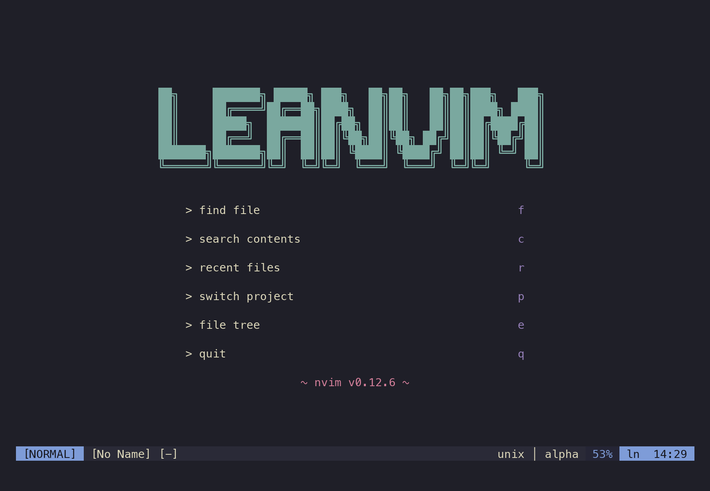

# LeanVim

Replace VSCode! A Neovim config with only what's necessary.



## Requirements

- Neovim 0.12+
- git, fzf, ripgrep (fd optional)

## Install

```sh
git clone https://github.com/BV003/LeanVim ~/.config/nvim
```

Open `nvim` and confirm to install plugins on first launch.

## Keymaps

Leader is `Space`.

| Key | Action |
|---|---|
| `Space f` | Find files |
| `Space c` | Search contents |
| `Space r` | Recent files |
| `Space p` | Switch project |
| `Space e` | File tree |
| `Space g` | Git changes |
| `Space w` / `Ctrl s` | Save |
| `Space q` | Close window |
| `Space \|` / `Space -` | Split left/right, top/bottom |
| `Ctrl h/j/k/l` | Move between windows |

Right-click in the file tree to create, rename, copy path, or delete.

## Projects

`Space p` lists folders under the roots in `lua/config/local.lua`:

```lua
return {
  project_roots = { "~/code" },
  projects = { "~/notes" },
}
```
